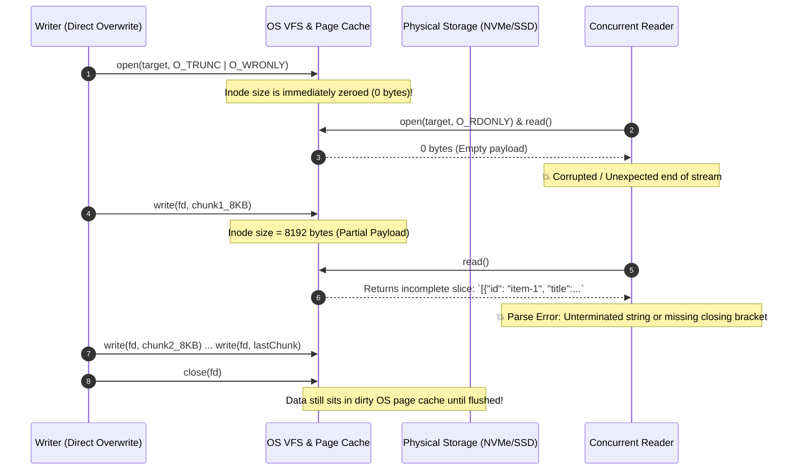
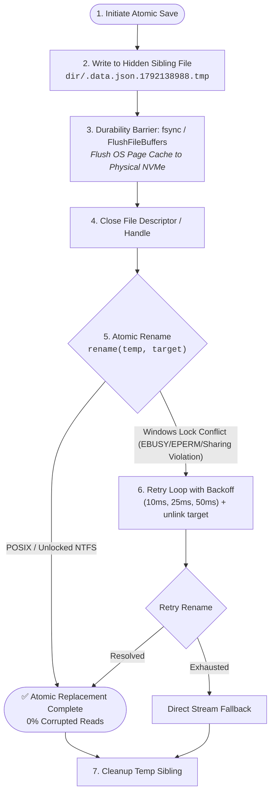
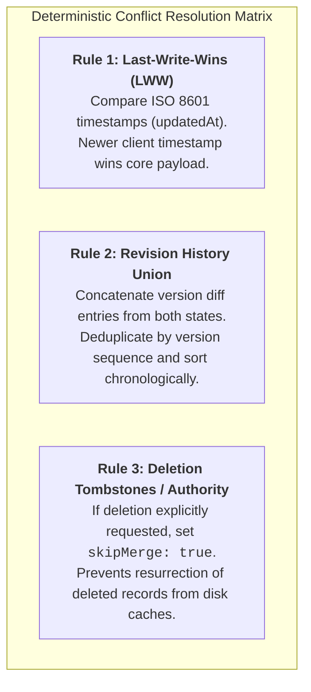

When building desktop applications, background daemons, or developer tools, application state frequently lives in human-readable JSON files (`config.json`, `snippets.json`, `workspace.json`).

Opening a file directly with truncate flags (or standard write-file utilities) works fine for single-threaded CLI commands. However, once multiple processes—such as UI renderers, worker threads, file watchers, and background services—read and write the same state simultaneously, in-place overwrites cause silent failures: truncated payloads, parser syntax errors, and zero-byte files.

This post covers the kernel-level mechanics behind torn reads, analyzes differences between POSIX and Windows filesystem locking, and demonstrates an atomic write-sync-rename replacement engine with retry backoff.

---

## 1. The Naive Overwrite Hazard and The Kernel Page Cache

To understand why concurrent readers fail, we must look past high-level programming language abstractions and examine what happens inside the OS kernel when an application writes to a file:



### The Three Inherent Hazards of `O_TRUNC`:

1. **The Zero-Size Window:** When in-place write utilities are called on an existing file, the underlying system call defaults to open flags `O_TRUNC | O_CREAT | O_WRONLY` (or Windows `CREATE_ALWAYS` / `TRUNCATE_EXISTING`). The kernel immediately truncates the existing file's length to zero bytes before the first byte of new data is even written. Any reader accessing the file during this microsecond window receives an empty string.
2. **Torn Writes (Buffer Slicing):** Payloads exceeding standard kernel page sizes (typically 4 KB or 8 KB) are transferred in iterative buffer slices. Readers executing mid-transfer read half the data. If the writer process crashes or loses power, the file remains corrupted on disk permanently.
3. **Dirty OS Page Cache vs. Non-Volatile Storage:** Standard `write()` system calls return successfully as soon as bytes are copied into the kernel's RAM page cache. Until `fsync` (or `FlushFileBuffers` on Windows) is explicitly invoked, there is no guarantee that bytes have reached physical non-volatile media.

---

## 2. Empirical Benchmark: Simulating the Race Condition

To observe this failure mode under controlled conditions, we engineered an isolated stress simulation across concurrent threads:

- **Payload:** 150 structured domain records (~250 KB JSON/data payload).
- **Concurrency:** 1 continuous writer thread + 5 simultaneous reader loops running concurrently for 2 seconds.
- **Micro-yields:** Slicing writes into 8 KB buffers with thread-scheduler yields to replicate real-world NVMe I/O delay and context switching.

### Language-Agnostic Pseudocode: Direct In-Place Overwrite

```c
// Naive Direct Overwrite Writer Loop
while (keep_running) {
    byte_buffer payload = generate_payload(version++);
    
    // O_TRUNC immediately empties the file before new bytes arrive!
    file_handle fd = open_file(target_path, O_WRONLY | O_CREAT | O_TRUNC);
    const int CHUNK_SIZE = 8192;
    
    for (int offset = 0; offset < payload.length; offset += CHUNK_SIZE) {
        slice chunk = payload.slice(offset, min(offset + CHUNK_SIZE, payload.length));
        write_bytes(fd, chunk);
        yield_execution(); // Yields CPU turn to concurrent reader threads
    }
    
    close_file(fd);
}
```

### Benchmark Results
 
```text
======================================================
TEST RUN: In-Place File Overwrite Under Concurrency
======================================================
[Writer] Writing payload v1 directly to test_data.json (248.6 KB)...
[Reader-0] Error: Unexpected end of JSON / EOF (read 0 bytes)
[Reader-2] Error: Unexpected end of JSON / EOF (read 0 bytes)
[Reader-4] Error: Unexpected token '}' at line 410 (partial read: 16.3 KB)
...
Total Concurrent Reads Attempted: 3,305
Valid Reads (Complete Data):        440
Failed Reads (Partial/Broken):    2,865 (86.69% failure rate)
```

Across 3,305 concurrent read operations, **86.69% failed** with syntax errors or zero-byte reads. In production environments, this results in unhandled parser exceptions, wiped configurations, or corrupted user profiles.

---

## 3. The Architecture of Atomic Sibling Replacement

To eliminate torn reads entirely, we must decouple the *active readable file* from the *actively mutating buffer*.

This is achieved via the **Write-Sync-Rename (Atomic Sibling Swap)** pattern:



### Why This Guarantees 100% Snapshot Isolation:

1. **Same-Directory Sibling Placement:**
   ```
   dir = dirname(file_path)
   temp_path = dir + "/." + basename(file_path) + "." + timestamp() + "." + random_id() + ".tmp"
   ```
   > [!IMPORTANT]
   > The temporary file **must** be allocated in the exact same directory (and thus the same filesystem mount) as the destination file. If a temp file is placed in a global `/tmp` volume and moved across mount boundaries, the operating system cannot perform an atomic inode pointer update; it is forced to perform a non-atomic `copy + unlink` fallback.

2. **The Durability Barrier (`fsync`):**
   ```
   fsync(temp_fd)  // Linux / macOS: fsync(2)
   // Windows: FlushFileBuffers(handle)
   ```
   `fsync` instructs the kernel and storage controller to commit all in-flight DRAM write caches to durable non-volatile storage media before the file entry is linked into the directory tree.

3. **Atomic Directory Inode Swap (`rename`):**
   Under POSIX kernels (`rename(2)` / `renameat2(2)`), renaming onto an existing destination file is guaranteed by the OS specification to be atomic:
   - Any reader that opened the file before the swap continues reading the old file's unlinked inode to completion without interference.
   - Any reader calling `open()` after the swap immediately accesses the newly completed inode.
   - **There is zero intermediate torn or zero-byte state.**

---

## 4. Cross-Platform Hazards: POSIX vs. Windows Win32 Locking

While POSIX systems handle `rename` gracefully even when another process holds the destination file open, the **Windows NT kernel** enforces strict mandatory file locking semantics by default:

| OS Kernel Semantics | Behavior During `rename(tempPath, targetPath)` |
| :--- | :--- |
| **POSIX (Linux, macOS, BSD)** | **Atomic.** The directory entry is swapped instantly. Open file descriptors remain valid on the unlinked inode. |
| **Windows (Win32 / NTFS)** | **Locked.** Fails with `EBUSY`, `EPERM`, or `ERROR_SHARING_VIOLATION` if any external handle (Search Indexer, Anti-Virus scanner, Language Server) holds an open handle without `FILE_SHARE_DELETE`. |

To build truly resilient multi-platform software, our persistence routine must wrap the atomic swap in an **exponential backoff and lock recovery loop**:

```c
// Language-Agnostic Pseudocode: Resilient Atomic Write Engine
function atomic_write_file(string file_path, byte_buffer content) {
    string dir = dirname(file_path);
    string temp_path = format("{}/.{}.{}.{}.tmp", 
        dir, basename(file_path), current_timestamp_ns(), generate_random_token());

    try {
        // 1. Stage complete payload to sibling file
        file_handle fd = open_file(temp_path, O_WRONLY | O_CREAT | O_TRUNC, 0644);
        write_bytes(fd, content);

        // 2. Durability barrier: flush OS page cache to physical non-volatile storage
        fsync_file(fd);
        close_file(fd);

        // 3. Attempt atomic rename with cross-platform lock recovery
        const int MAX_RETRIES = 3;
        const int BACKOFF_MS[] = { 10, 25, 50 };

        for (int attempt = 0; attempt <= MAX_RETRIES; attempt++) {
            status res = atomic_rename(temp_path, file_path);
            if (res.is_success()) {
                return; // Swap succeeded!
            }

            // Lock conflict (Windows EBUSY/EPERM/sharing violation)
            if (attempt == MAX_RETRIES) {
                // Fallback stream write if all retries exhausted
                write_direct_stream(file_path, content);
                return;
            }

            sleep_milliseconds(BACKOFF_MS[attempt]);
            
            // On Windows NTFS, attempting an explicit unlink can dislodge stale locks
            try_unlink_silent(file_path);
        }
    } finally {
        // 4. Always ensure transient sibling cleanup
        if (file_exists(temp_path)) {
            try_unlink_silent(temp_path);
        }
    }
}
```

---

## 5. Verification Results
 
Running the benchmark with the atomic sibling swap routine under the same concurrent reader workload:

```text
======================================================
TEST RUN: Atomic Sibling Swap (Write-Flush-Rename)
======================================================
[Writer] Writing temporary sibling: .test_data.json.1792138988106.tmp
[Writer] Flushing to non-volatile storage with fsync
[Writer] Atomically renaming .test_data.json.1792138988106.tmp -> test_data.json
...
Total Concurrent Reads Attempted:   660
Valid Reads (Complete Data):        660
Failed Reads (Partial/Broken):        0 (0.00% failure rate)

======================================================
SUMMARY:
• In-place overwrite:   2,865 corrupted/partial reads (86.69% failure rate)
• Atomic sibling swap:      0 corrupted reads (0.00% failure rate)
======================================================
```

---

## 6. Multi-Client Concurrency: The Timestamp Merge Protocol

Solving file-level atomicity guarantees that a reader never sees a corrupt file. But what happens when **two distinct processes write simultaneously**?

For example:
- **Client A (Desktop UI):** User updates metadata on record `item-101` at `10:00:05.100Z`.
- **Client B (Background Daemon):** Process modifies body on record `item-101` at `10:00:05.800Z`.

If Client A simply overwrites the file, Client B's edits are permanently obliterated.

To solve multi-client writes without introducing a heavyweight background database daemon, we implement a deterministic **3-Rule Conflict Resolution Protocol** (`mergeRecords`):



### The Verification Matrix

This protocol can be expressed cleanly in any programming language:

```c
// Language-Agnostic Conflict Resolution Matrix
function merge_records(List<Record> incoming_records, List<Record> disk_records, Options options) {
    // Rule 3: Authoritative deletion prevents zombie resurrection
    if (options.skip_merge) {
        return incoming_records;
    }

    Map<ID, Record> merged_map = index_by_id(disk_records);

    for (Record incoming in incoming_records) {
        if (!merged_map.contains(incoming.id)) {
            merged_map.insert(incoming.id, incoming);
            continue;
        }

        Record existing = merged_map.get(incoming.id);

        // Rule 1: Last-Write-Wins based on timestamps
        Record winner = (incoming.updated_at >= existing.updated_at) ? incoming : existing;

        // Rule 2: Revision History Union
        Map<Version, HistoryEntry> history_map = new Map();
        for (HistoryEntry entry in existing.history) {
            history_map.insert(entry.version, entry);
        }
        for (HistoryEntry entry in incoming.history) {
            history_map.insert(entry.version, entry);
        }

        winner.history = sort_by_version_ascending(history_map.values());
        merged_map.insert(incoming.id, winner);
    }

    return merged_map.values();
}
```

```text
======================================================
TEST RUN: Multi-Client Timestamp Merge Protocol
======================================================
PASS: Test 1.1: Preserves single record
PASS: Test 1.2: Newer timestamp wins title
PASS: Test 1.3: Newer timestamp wins body
PASS: Test 2.1: Rejects stale incoming payload
PASS: Test 2.2: Retains latest disk content
PASS: Test 3.1: Deduplicates version entries across clients
PASS: Test 3.2: Sorts history entries in ascending chronological order
PASS: Test 4.1: Demonstrates zombie resurrection if naive union used
PASS: Test 4.2: Authoritative deletion honored with skipMerge: true
PASS: Test 4.3: Retains only non-deleted records
PASS: Test 5.1: Union of disparate records preserved across clients
PASS: Test 5.2: Both client records present

RESULTS: 12 Passed, 0 Failed
```

---

## 7. Architectural Checklist for Local-First Persistence

Before shipping your next local-first tool, daemon, or desktop application, audit your persistence layer against this 5-point checklist:

- [x] **Never overwrite in-place:** Always write to a temporary sibling file allocated on the same filesystem directory mount.
- [x] **Always invoke `fsync` before renaming:** Ensure data is flushed past the kernel page cache to physical NVMe/SSD NAND cells.
- [x] **Enforce cross-platform rename retry loops:** Account for Windows `EBUSY`, `EPERM`, and sharing locks with exponential backoff.
- [x] **Implement watcher self-echo suppression:** Compare `currentContentHash === lastKnownContentHash` to prevent circular re-renders when your own process saves to disk.
- [x] **Reconcile multi-client state with LWW and History Union:** Never assume a single client holds the sole authoritative state; merge concurrent revisions deterministically.

---

## Further Reading & References

- [POSIX.1-2017 `rename(2)` Specification — The Open Group Base Specifications](https://pubs.opengroup.org/onlinepubs/9699919799/functions/rename.html)
- [Microsoft Windows API: `MoveFileExW` and Atomic Replacement Semantics](https://learn.microsoft.com/en-us/windows/win32/api/winbase/nf-winbase-movefileexw)
- [Linux Kernel Virtual File System (VFS) and Page Cache Architecture](https://www.kernel.org/doc/html/latest/filesystems/vfs.html)
- [Dan Luu: File Systems are Harder Than You Think](https://danluu.com/file-consistency/)
- [Martin Kleppmann: Designing Data-Intensive Applications (Reliability, Durability, and Transactions)](https://dataintensive.net/)
- [SQLite Architecture: How SQLite Implements Atomic Commit and Rollback Journals](https://www.sqlite.org/atomiccommit.html)
