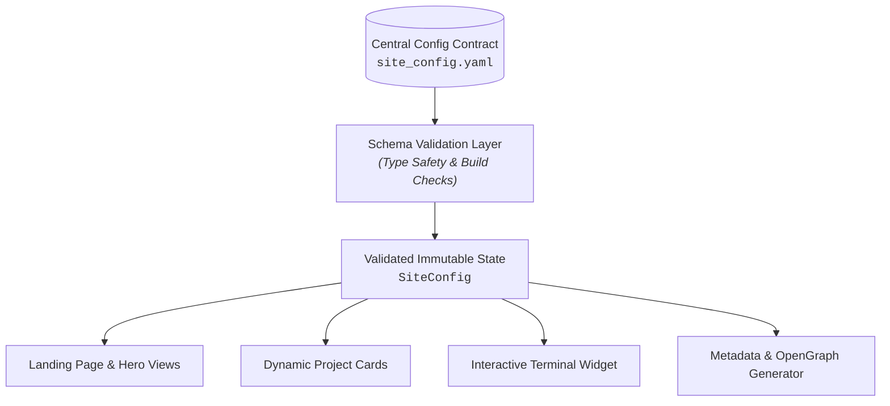

# Building a Config-Driven Developer Portfolio

Developer portfolios and content-driven websites often become brittle and unmaintained because updating personal details, career timelines, or featured projects requires hunting through deeply nested presentation components.

By designing a **centralized, schema-driven configuration architecture**, we cleanly decouple content and business data from visual layout layers.

## The Anti-Pattern: Hardcoded Presentation Components

When profile records, social links, project metadata, and metrics are duplicated across landing pages, sidebars, footers, and interactive widgets, making a single update becomes error-prone and causes drift across components:

```c
// Anti-Pattern: Hardcoded data scattered across presentation modules
render_hero_header()    => Display("Sagar Kumar Jha - Systems & Full-Stack Engineer")
render_about_card()     => Display("Building developer tools and systems from first principles")
render_footer_summary() => Display("Copyright © Sagar Kumar Jha")
```

## The Solution: A Typed Declarative Schema Contract



Define your data schema as a single authoritative model:

```yaml
# Authoritative Configuration Contract (site_config.yaml)
profile:
  name: "Sagar Kumar Jha"
  role: "Systems & Full-Stack Engineer"
  location: "Delhi, India"
  socials:
    github: "sagarkrjha"
    linkedin: "devsagarkumarjha"
    x: "devsagarkrjha"
  
featured_projects:
  - id: "minigit"
    title: "MiniGit"
    description: "Git version control engine implementation from first principles"
    tags: ["Systems", "C++20", "Algorithms"]
  - id: "codeshelf"
    title: "CodeShelf"
    description: "Local-first snippet manager with atomic persistence"
    tags: ["TypeScript", "Storage", "Electron"]
```

```c
// Core Architecture: Single source of truth consumed across all presentation layers
struct SiteConfig {
    Profile profile;
    List<Project> featured_projects;
    List<SkillCategory> skills;
};

// All views, CLI scripts, and build generators consume the same validated configuration
SiteConfig config = load_and_validate_config("site_config.yaml");
```

Now, every presentation component—from statically generated landing pages to interactive console widgets—binds directly to this validated schema contract.

## Conclusion

This approach gives you:
1. **Single Point of Update**: Change your configuration file, and every page and component reflects the update.
2. **Type Safety**: Invalid configurations trigger build-time errors before reaching production.
3. **Clean Decoupling**: Visual redesigns don't risk losing content or breaking data formats.

---

## Further Reading & References

- [Next.js Documentation: Project Structure and Architecture Patterns](https://nextjs.org/docs/app/getting-started/project-structure)
- [TypeScript Documentation: Type Narrowing, Discriminated Unions, and Schemas](https://www.typescriptlang.org/docs/handbook/2/narrowing.html)
- [Addy Osmani: Design Patterns for Clean, Extensible Web Applications](https://www.patterns.dev/)
- [Zod Documentation: Declarative Type Validation and Data Contract Enforcement](https://zod.dev/)
