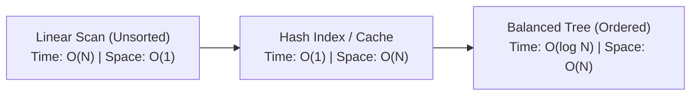

# Understanding Algorithms: Space-Time Complexity in Practice

Big-O notation is often treated purely as an interview topic, but understanding algorithmic complexity is critical when designing high-throughput backend pipelines, real-time databases, and responsive UI application states.

## Why Complexity Matters

Consider searching through an unsorted collection versus maintaining an indexed hash map:

```c
// Linear Scan: O(N) time, O(1) auxiliary space
function find_element(Collection items, Predicate match) {
    for (item in items) {
        if (match(item)) {
            return item;
        }
    }
    return null;
}

// Key-Value Hash Index: O(1) amortized lookup, O(N) space
Map<Key, Value> index = build_hash_index(items);
Value target = index.get(lookup_key);
```

## Space-Time Tradeoffs



Across system architectures, caching, indexing, and memoization are direct applications of the classic space-time tradeoff:

* **Memory Investment ($O(N)$ space)**: Allocating memory for precomputed results, lookup tables, and in-memory indexes.
* **Latency Reduction ($O(1)$ time)**: Eliminating redundant re-evaluations, disk traversals, and network roundtrips.

## Summary

Always evaluate your algorithm against your runtime problem constraints:
* If input size $N \le 10^3$, quadratic algorithms ($O(N^2)$) may be acceptable for small configurations.
* If input size $N \ge 10^5$, you must target sub-quadratic bounds: $O(N \log N)$ or strictly linear $O(N)$.

---

## Further Reading & References

- [Thomas H. Cormen, Charles E. Leiserson, Ronald L. Rivest, Clifford Stein: Introduction to Algorithms (CLRS)](https://mitpress.mit.edu/9780262046305/introduction-to-algorithms/)
- [Steven S. Skiena: The Algorithm Design Manual](https://www.algorist.com/)
- [Tim Roughgarden: Algorithms Illuminated Series](https://www.algorithmsilluminated.org/)
- [V8 Dev Blog: Optimizing JavaScript Array and Map Lookups](https://v8.dev/blog/elements-kinds)
- [Brendan Gregg: Systems Performance — Enterprise and the Cloud](https://www.brendangregg.com/systems-performance-2nd-edition-book.html)
